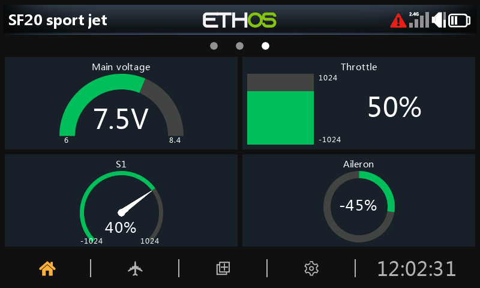
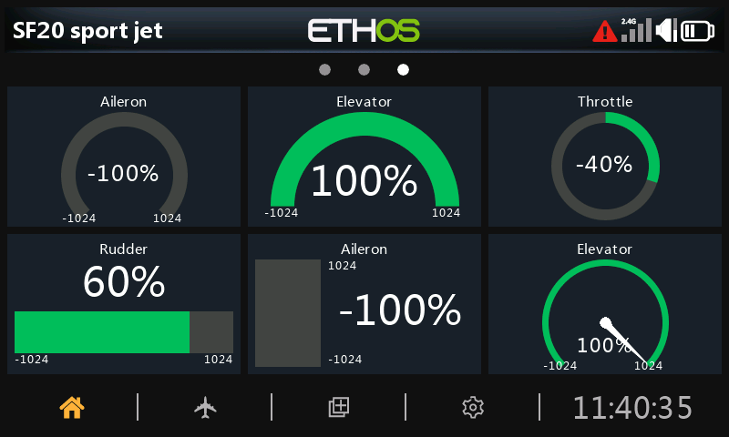
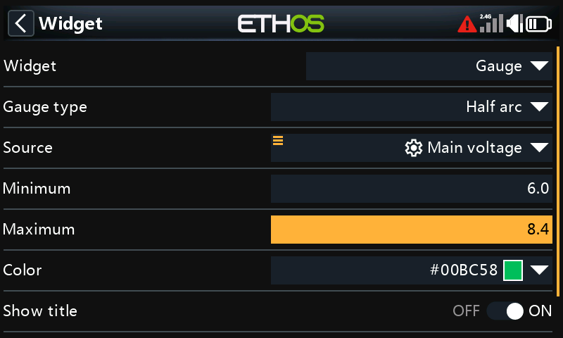
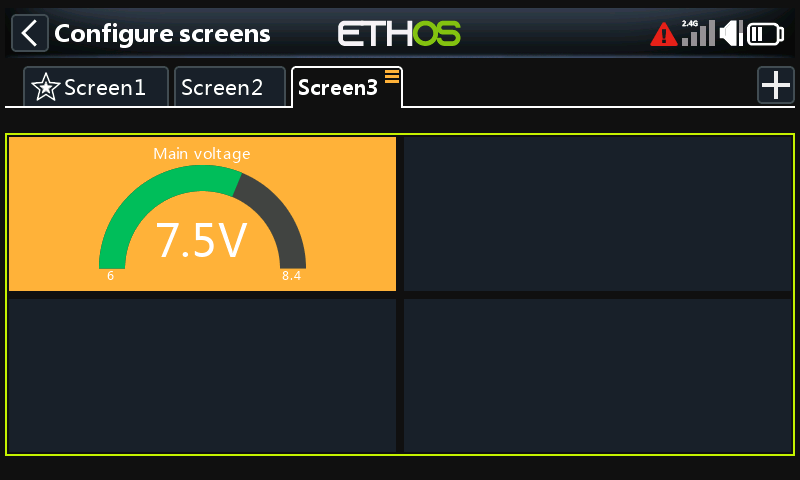

# Ethos Gauges

A configurable gauge widget for **FrSky Ethos** radios.

Install it once, then drop a **Gauge** into any screen slot and choose what it shows: the gauge style, the source (telemetry, stick, pot, channel, radio battery...) and the range it covers. Each slot keeps its own settings, so one screen can hold several different gauges.



## Contents

- [Gauge types](#gauge-types)
- [Install](#install)
- [Add a gauge to a screen](#add-a-gauge-to-a-screen)
- [Settings](#settings)
- [Example gauges](#example-gauges)
- [Good to know](#good-to-know)
- [Development](#development)
- [Builds and releases](#builds-and-releases)

## Gauge types



| Type | Shape | Good for |
| --- | --- | --- |
| **Arc** | 270° arc, value in the middle | General purpose: voltage, RPM, current |
| **Half arc** | 180° arc, value under the arc | Wide, short slots; battery and fuel |
| **Ring** | Full circle | Square slots; percentages such as fuel or link quality |
| **Horizontal bar** | Value above a bar | Wide, short slots; throttle, RSSI |
| **Vertical bar** | Bar on the left, value on the right | Tall or medium slots; throttle, tank level |
| **Needle dial** | 270° dial with a needle | An instrument look: airspeed, RPM, temperature |

Every type scales to the slot it is placed in. The value font is the largest that fits.

## Install

**From a release (recommended)**

1. Download `ethos-gauges-<version>-<lang>.zip` for your language from the [Releases](../../releases) page. Languages: `en`, `de`.
2. In **FrSky Suite**, open **Lua library → Install from local .zip** and pick the zip.

**By hand**

Unzip the release and copy the `gauges` folder to the `scripts` folder of the radio's SD card or internal storage, so you end up with `SCRIPTS:/gauges/main.lua`. Restart the radio.

**In the web simulator**

Open <https://ethos-simulator.frsky-rc.com>, choose **Upload a Lua plugin** and pick the zip.

## Add a gauge to a screen

1. Press **DISP** (or tap the **Screens** icon) to open **Configure screens**.
2. Pick a screen, or tap **+** to add one and choose a layout.
3. Tap an empty slot, then set **Widget** to **Gauge**.
4. Set the gauge type, source and range (see [Settings](#settings)), then go back.



The gauge shows up straight away in the screen editor:



To change a gauge later, open **Configure screens** again and tap its slot.

## Settings

| Setting | What it does |
| --- | --- |
| **Gauge type** | One of the six [gauge types](#gauge-types). |
| **Source** | What the gauge shows: any Ethos source. Picking a source fills **Minimum** and **Maximum** with that source's own range, when it has one. |
| **Minimum** | The value at the empty end of the gauge (one decimal place). |
| **Maximum** | The value at the full end of the gauge (one decimal place). |
| **Color** | Fill color of the arc, ring or bar. |
| **Show title** | Shows the source name at the top of the slot. Turn it off to give the gauge more room. |
| **Show min/max** | Shows the Minimum and Maximum values at the ends of the gauge. |

Settings are saved in the model, per slot. Copying a model copies its gauges, and each model can have its own.

## Example gauges

Starting points for common setups. Sensor names depend on your receiver and ESC, so pick yours from the **Source** list. Tick **Show min/max** if you want to see the range on screen.

| Gauge | Type | Source | Min | Max |
| --- | --- | --- | --- | --- |
| Transmitter battery (2S Li-ion) | Half arc | System value → Main voltage | 6.6 | 8.4 |
| Flight pack, 6S LiPo | Arc | Telemetry → pack voltage sensor (e.g. `VFAS`) | 19.8 | 25.2 |
| Flight pack, 12S LiPo | Arc | Telemetry → pack voltage sensor | 39.6 | 50.4 |
| Receiver battery (2S LiFe) | Horizontal bar | Telemetry → `RxBatt` | 6.0 | 7.2 |
| Motor or headspeed RPM | Needle dial | Telemetry → RPM sensor | 0 | 3000 |
| Current draw | Arc | Telemetry → current sensor | 0 | 120 |
| Fuel / capacity left | Ring | Telemetry → fuel % sensor | 0 | 100 |
| Link quality | Horizontal bar | Telemetry → `RQly` (ELRS/Crossfire) or `RSSI` | 0 | 100 |
| ESC temperature | Needle dial | Telemetry → ESC temperature sensor | 20 | 120 |
| Throttle position | Vertical bar | Analogs → Throttle | -1024 | 1024 |
| Pot or slider | Needle dial | Analogs → S1 | -1024 | 1024 |
| Channel output | Ring | Channels → CH3 | -1024 | 1024 |

The screen at the top of this page was set up like this:

| Slot | Type | Source | Range |
| --- | --- | --- | --- |
| Top left | Half arc | Main voltage | 6.0 – 8.4 |
| Top right | Vertical bar | Throttle | -1024 – 1024 (pre-filled) |
| Bottom left | Needle dial | S1 | -1024 – 1024 (pre-filled) |
| Bottom right | Ring | Aileron | -1024 – 1024 (pre-filled) |

## Good to know

- **Sticks, pots and channels** have a raw range of -1024 to 1024. The gauge shows the value the way Ethos formats it (for example `50%`), but **Minimum** and **Maximum** use the raw range. Picking the source fills them in for you. To show only the top half of a stick, set Minimum to 0.
- **Reversed gauges**: set Minimum higher than Maximum and the gauge fills the other way. For example Minimum 100 and Maximum 0 on a fuel-used sensor shows fuel remaining.
- **Out of range** values stop at the end of the gauge. The number still shows the real value.
- **No value**: when the source has no value (for example a sensor that was never discovered), the gauge shows `--` and an empty track.
- **Several gauges with one source**: add as many as you like, each with its own type and range.
- The gauge redraws only when the displayed value changes, so it uses little CPU.

## Development

This repository uses the [Ethos Lua VS Code template](https://github.com/FrSkyRC/ethos-lua-vscode-template) tooling and the CI / release model of the Rotorflight and Wingflight Ethos suites.

```text
src/gauges/               the Lua that goes to the radio (SCRIPTS:/gauges/)
  main.lua                registers the widget
  widget.lua              the gauge: create / wakeup / paint / configure / read / write
  lib/util.lua            font fitting, logging
  ethos_lua_manifest.json package name / key / version
i18n/                     en.json, de.json ... (@i18n(key)@ tags in the Lua)
bin/package/              build_package.py, validate_ethos_manifest_zip.py
bin/i18n/check_keys.py    every language has the keys of en.json, every tag resolves
docs/images/              README screenshots
.vscode/                  ▶ Deploy & Launch [SIM], Deploy Radio, Serial Debug ...
.github/                  pr / push / release / snapshot workflows
```

| Goal | Command |
| --- | --- |
| Deploy to the simulator | ▶ **Deploy & Launch [SIM]**, or `python .vscode/scripts/deploy.py --lang en --step i18n` |
| Deploy to a radio on USB | ▶ **Deploy Radio [Fast]** |
| Build installable zips | `python bin/package/build_package.py --all-langs` (into `dist/`) |
| Check translations | `python bin/i18n/check_keys.py` |

To test in the simulator without VS Code, use [FrSkyRC/ethos-tools](https://github.com/FrSkyRC/ethos-tools) (`simulation/run_wasm.js --serve`, or its Claude Code plugin). [AGENTS.md](AGENTS.md) has the coding rules and the widget's internals.

The widget key is `etgauge` and the manifest key is `com.robthomson.ethos-gauges`. Models refer to these, so they must never change.

### Translations

Add `i18n/<lang>.json` with the same keys as `en.json`, then add the language code to `inputs.deployLanguage.options` in `.vscode/launch.json`. The workflows build every language they find in `i18n/`.

## Builds and releases

| Workflow | Trigger | Produces |
| --- | --- | --- |
| `pr.yml` | Pull request | Test zips per language (`ethos-gauges-PR-<n>-<lang>.zip`) and the i18n key check |
| `push.yml` | Push to `main` | Zips per language (`ethos-gauges-commit-<sha7>-<lang>.zip`) |
| `release.yml` | Tag `release/1.2.0` | GitHub **Release**; `release/1.2.0-rc1` gives a **Release Candidate** (pre-release) |
| `snapshot.yml` | Tag `snapshot/1.2.0-dev3` | **Snapshot** pre-release |

Every build runs `.github/actions/build-zips`, which packages the zips, runs `luac5.4 -p` on every resolved `.lua` file and validates the manifest.

To release:

1. Update `version` in `src/gauges/ethos_lua_manifest.json`.
2. Add a `# 1.2.0` section at the top of `Releases.md`. It becomes the GitHub release notes and the notes shown in FrSky Suite.
3. Commit, then run `git tag release/1.2.0 && git push origin release/1.2.0`.

The manifest version must be numeric `X.Y.Z`. For `1.2.0-rc1` the manifest gets `1.2.0`, and the full label is kept in `gauges/build_info.lua`.
